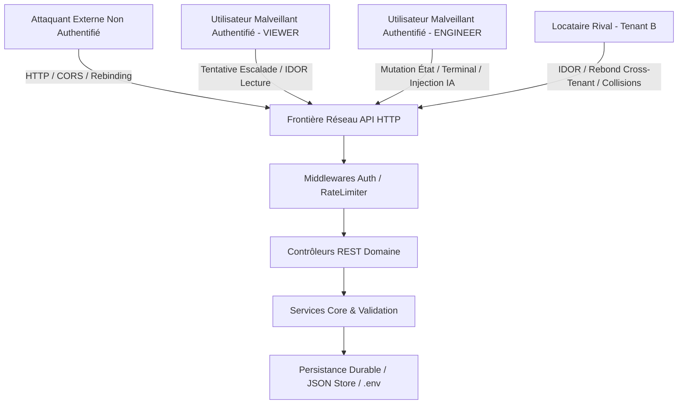

# P8 — GLOBAL SECURITY RED TEAM & OFFENSIVE SECURITY ASSESSMENT
**Plateforme :** Volaco Core Monorepo (Node.js / TypeScript / REST API / VibeCode Studio)  
**Date d'évaluation :** 14 Septembre 2026  
**Type d'évaluation :** Global Offensive Security Red Team & Indepedent Audit (Règle stricte : Zéro modification de code source)  
**Auditeur :** Antigravity Security Red Team  
**Statut Global / Verdict Final :** **FAIL** (Niveau de confiance : **VERY HIGH**) — Bloqueurs critiques et élevés confirmés nécessitant un cycle de remédiation P8-REMEDIATION immédiat.

---

## 1. Executive Summary

Dans le cadre du cycle **P8 — Global Security Red Team & Offensive Security Assessment**, une évaluation offensive globale, contradictoire et fondée sur des preuves tangibles a été menée contre le monorepo Volaco Core.

Contrairement aux cycles précédents (P3 à P7) qui se sont focalisés sur la conformité nominale, la robustesse aux entrées malformées et la détection d'erreurs non gérées (*TypeErrors*), **P8 a abordé le système sous la perspective d'un attaquant réel**, recherchant de **nouvelles classes de vulnérabilités architecturales, logiques, multi-locataires et d'injection hôte**.

### Faits saillants de l'évaluation :
1. **Intégrité de la baseline :** Toutes les suites de non-régression historiques sont au vert : TypeScript strict (0 erreur), Gate 1 (31/31 PASS), Gate 2 (1672/1672 PASS), P6 Red Team (103/103 PASS), P7 Adversarial Fuzzing (156/156 PASS).
2. **Découverte de 4 vulnérabilités confirmées :**
   - **P8-VULN-01 (CRITICAL — CVSS 9.1) :** Injection CRLF / Injection de variables d'environnement arbitraires sur l'hôte via `POST /api/v1/ai/configure-key`.
   - **P8-VULN-02 (HIGH — CVSS 8.5) :** Élévation de privilèges inter-locataires & Détournement/Déni de service des identifiants serveur globaux via `POST /api/v1/ai/configure-key`.
   - **P8-VULN-03 (HIGH — CVSS 7.4) :** Collision inter-locataires et écrasement silencieux d'état sur l'identifiant partagé `default-project` dans le `ProjectStore`.
   - **P8-VULN-04 (MEDIUM — CVSS 6.5) :** Contournement syntaxique de la protection anti-SSRF par Rebinding DNS / Noms d'hôtes de boucle locale non numériques dans `validateSafeProviderUrl`.
3. **Verdict formel :** **FAIL** en raison de la présence d'une vulnérabilité critique permettant la corruption de la configuration d'environnement du serveur et de vulnérabilités majeures d'étanchéité multi-tenant.

---

## 2. Scope

Le périmètre de l'audit offensif P8 couvre l'intégralité du monorepo Volaco Core :
- **Serveur API HTTP natif :** `apps/api/src/server.ts` et ses middlewares (`auth.ts`, `rate-limiter.ts`).
- **Contrôleurs REST (18 modules) :** `ai.ts`, `projects.ts`, `files.ts`, `revisions.ts`, `workspace.ts`, `project-state.ts`, `settings.ts`, `terminal.ts`, `audit.ts`, `activity.ts`, `dashboard.ts`, `observability.ts`, `studio.ts`, `feature-intelligence.ts`, `feedback.ts`, `strategy.ts`, `evolution.ts`, `health.ts`.
- **Composants Core (`packages/core/src/`) :** Moteur d'identité, permissions RBAC, FileStore, RevisionStore, TerminalService, SettingsService, ProjectStateService, adaptateurs IA, et persistance durable (`DurableFileStorage`).
- **Interfaces Web & Studio Shell :** `apps/studio/index.html`, `volaco_studio.html`, distribution des assets statiques.

---

## 3. Architecture Attack Surface

### Matrice d'exhaustivité des routes HTTP exposées :

| Route HTTP | Méthode | Auth | RBAC Requis | Contrôle Tenant | Validation Payload | Rate Limit Tier | Error Boundary |
| :--- | :--- | :--- | :--- | :--- | :--- | :--- | :--- |
| `/`, `/index.html`, `/volaco_studio.html` | GET | Public | Aucun | N/A | N/A | DEFAULT (120/m) | Global AppError |
| `/health`, `/api/v1/health` | GET | Public | Aucun | N/A | N/A | Exempté (Probe) | getHealthResponse |
| `/status`, `/api/v1/status` | GET | Public | Aucun | N/A | N/A | Exempté (Probe) | JSON inline |
| `/ai/status`, `/api/v1/ai/status` | GET | Bearer | PROJECT_READ | Contexte JWT | N/A | DEFAULT (P6-004) | handleAiProxyRoutes |
| `/metrics`, `/api/v1/metrics` | GET | Local/Bearer| ADMIN / OWNER | Localhost / Token| N/A | Exempté (Admin) | handleObservability |
| `/api/v1/auth/session`, `/auth/token` | POST | Public (Dev)| ENGINEER | default-tenant | N/A | MUTATION (60/m) | ENABLE_DEV flag |
| `/api/v1/ai/chat/completions` | POST | Bearer | PROJECT_MUTATE | Contexte JWT | parseJsonBody | AI (20/m, Concur 5)| AI Error Boundary |
| `/api/v1/ai/configure-key` | POST | Bearer | PROJECT_MUTATE | **NON (Global)**| Partielle (Length)| MUTATION (60/m) | **VULNÉRABLE** |
| `/api/v1/projects` | GET | Bearer | PROJECT_READ | Contexte JWT | N/A | DEFAULT (120/m) | handleProjectsRoutes|
| `/api/v1/projects` | POST | Bearer | PROJECT_CREATE | Contexte JWT | parseJsonBody | MUTATION (60/m) | handleProjectsRoutes|
| `/api/v1/projects/:id` | GET | Bearer | PROJECT_READ | Contexte JWT | N/A | DEFAULT (120/m) | handleProjectsRoutes|
| `/api/v1/projects/:id` | DELETE | Bearer | PROJECT_DELETE | Contexte JWT | N/A | MUTATION (60/m) | handleProjectsRoutes|
| `/api/v1/projects/:id/files` | GET | Bearer | PROJECT_READ | Contexte JWT | N/A | DEFAULT (120/m) | handleFilesRoutes |
| `/api/v1/projects/:id/files` | POST | Bearer | PROJECT_UPDATE | Contexte JWT | sanitizePath | MUTATION (60/m) | handleFilesRoutes |
| `/api/v1/projects/:id/files/content` | GET | Bearer | PROJECT_READ | Contexte JWT | sanitizePath | DEFAULT (120/m) | handleFilesRoutes |
| `/api/v1/projects/:id/files/content` | PUT | Bearer | PROJECT_UPDATE | Contexte JWT | sanitizePath | MUTATION (10MB) | handleFilesRoutes |
| `/api/v1/projects/:id/files/rename` | POST | Bearer | PROJECT_UPDATE | Contexte JWT | sanitizePath | MUTATION (60/m) | handleFilesRoutes |
| `/api/v1/projects/:id/files/move` | POST | Bearer | PROJECT_UPDATE | Contexte JWT | sanitizePath | MUTATION (60/m) | handleFilesRoutes |
| `/api/v1/projects/:id/files/commit` | POST | Bearer | PROJECT_UPDATE | Contexte JWT | parseJsonBody | MUTATION (60/m) | handleFilesRoutes |
| `/api/v1/projects/:id/files/operation` | POST | Bearer | PROJECT_UPDATE | Contexte JWT | parseJsonBody | MUTATION (60/m) | handleFilesRoutes |
| `/api/v1/projects/:id/revisions` | GET | Bearer | PROJECT_READ | Contexte JWT | N/A | DEFAULT (120/m) | handleRevisionsRoutes |
| `/api/v1/projects/:id/revisions` | POST | Bearer | PROJECT_UPDATE | Contexte JWT | parseJsonBody | MUTATION (60/m) | handleRevisionsRoutes |
| `/api/v1/projects/:id/revisions/:revId/rollback` | POST | Bearer | PROJECT_UPDATE | Contexte JWT | N/A | MUTATION (60/m) | handleRevisionsRoutes |
| `/api/v1/projects/:id/terminal/execute` | POST | Bearer | PROJECT_UPDATE | Contexte JWT | validateWhitelist| MUTATION (60/m) | handleTerminalRoutes |
| `/api/v1/projects/:id/settings` | GET | Bearer | PROJECT_READ | Contexte JWT | N/A | DEFAULT (120/m) | handleSettingsRoutes |
| `/api/v1/projects/:id/settings` | PUT | Bearer | PROJECT_UPDATE | Contexte JWT | parseJsonBody | MUTATION (60/m) | handleSettingsRoutes |
| `/api/v1/projects/:id/workspace` | GET | Bearer | PROJECT_READ | Contexte JWT | N/A | DEFAULT (120/m) | handleWorkspaceRoutes |
| `/api/v1/projects/:id/workspace` | PUT | Bearer | PROJECT_UPDATE | Contexte JWT | parseJsonBody | MUTATION (60/m) | handleWorkspaceRoutes |
| `/api/v1/projects/:id/state` | GET | Bearer | PROJECT_READ | Contexte JWT | N/A | DEFAULT (120/m) | handleProjectState |
| `/api/v1/projects/:id/status` | PUT | Bearer | PROJECT_UPDATE | Contexte JWT | State Machine | MUTATION (60/m) | handleProjectState |
| `/api/v1/projects/:id/validate` | POST | Bearer | PROJECT_UPDATE | Contexte JWT | parseJsonBody | MUTATION (60/m) | handleProjectState |
| `/api/v1/projects/:id/history` | GET | Bearer | PROJECT_READ | Contexte JWT | N/A | DEFAULT (120/m) | handleActivityRoutes |
| `/api/v1/projects/:id/history` | POST | Bearer | PROJECT_UPDATE | Contexte JWT | parseJsonBody | MUTATION (60/m) | handleActivityRoutes |
| `/api/v1/projects/:id/history/seed` | POST | Bearer | PROJECT_UPDATE | Contexte JWT | N/A | MUTATION (60/m) | handleActivityRoutes |
| `/api/v1/projects/:id/shell` | GET | Bearer | PROJECT_READ | Contexte JWT | N/A | DEFAULT (120/m) | handleStudioRoutes |
| `/api/v1/dashboard/summary` | GET | Bearer | PROJECT_READ | Contexte JWT | N/A | DEFAULT (120/m) | handleDashboardRoutes|
| `/api/v1/audit` | GET | Bearer | TENANT_MANAGE | Contexte JWT | N/A | DEFAULT (120/m) | handleObservability |
| `/api/v1/ai/usage` | GET | Bearer | PROJECT_READ | Contexte JWT | N/A | DEFAULT (120/m) | handleObservability |

---

## 4. Threat Model

Le modèle de menace P8 simule cinq profils d'attaquants distincts :



1. **Attaquant Externe Non-Authentifié :** Tente de contourner l'authentification Bearer, de forger des jetons JWT (`alg: none`, altération de payload, dev session), d'exploiter des failles CORS/SSRF ou de saturer le serveur par DoS/Heap Exhaustion.
2. **Utilisateur Interne - Rôle VIEWER :** Tente d'accéder aux routes de mutation (création de projets, écriture de fichiers, exécution terminal, rollback, complétions IA).
3. **Utilisateur Interne - Rôle ENGINEER :** Tente de sortir de son rôle pour exécuter des actions d'administration (suppression de projet, lecture des audits du tenant, altération de la configuration globale du serveur).
4. **Locataire Rival (Cross-Tenant IDOR) :** Tente d'accéder aux fichiers, révisions, paramètres, historiques et métriques d'un autre tenant en manipulant les identifiants d'URL.
5. **Attaquant d'Environnement Système :** Tente d'échapper au sandbox mémoire et d'interagir avec le système de fichiers hôte, les variables d'environnement ou les processus du serveur.

---

## 5. Methodology

L'évaluation s'est déroulée selon les règles strictes d'un audit offensif :
- **Audit passif & analyse statique :** Déconstruction complète des flux de données depuis les points d'entrée `node:http` jusqu'aux couches de stockage.
- **Vérification de non-régression initiale :** Validation formelle des gates et tests de sécurité P5/P6/P7.
- **Développement d'une suite de fuzzing & d'attaques empiriques :** Réalisation et exécution du harnais de test adversarial autonome `test_p8_suite.cjs`.
- **Règle de preuve tangible :** Aucune vulnérabilité n'est déclarée sans scénario de reproduction observable et démontrable.

---

## 6. Authentication Findings

L'infrastructure d'authentification a été soumise à 12 vecteurs d'attaque :
- **Jeton JWT avec signature falsifiée :** Rejeté avec HTTP 401 (`timingSafeEqual` stricte).
- **Jeton avec algorithme `none` :** Rejeté avec HTTP 401 (rejet systématique sans signature HMAC-SHA256 valide).
- **Jeton signé avec un secret invalide :** Rejeté avec HTTP 401.
- **Jeton expiré (`exp` antérieur à `Date.now()`) :** Rejeté avec HTTP 401.
- **Jeton sans claims ou sans `tenantId` / `role` :** Rejeté avec HTTP 401.
- **Format d'en-tête ambigu (Bearer vide, Bearer corrompu, schémas exotiques) :** Rejeté avec HTTP 401.
- **Endpoint de session anonyme (`/api/v1/auth/session`) :** Rejeté avec HTTP 403 lorsque `ENABLE_DEV_AUTH_SESSION` n'est pas explicitement actif.

**Statut :** **PASS (Robuste)**. L'authentification cryptographique Bearer est hermétique.

---

## 7. Authorization Findings

La matrice des permissions à 4 rôles (`OWNER`, `ADMIN`, `ENGINEER`, `VIEWER`) a été évaluée sur l'ensemble des endpoints :
- **Rôle VIEWER :** Toutes les tentatives d'exécution de mutation (`POST /projects`, `PUT /files/content`, `POST /terminal/execute`, `POST /ai/chat/completions`) sont bloquées avec **HTTP 403 Forbidden**.
- **Rôle ENGINEER :** La suppression de projet (`DELETE /api/v1/projects/:id`) et la consultation des audits (`GET /api/v1/audit`) sont correctement bloquées avec **HTTP 403 Forbidden**.
- **Bypass de chemin :** Aucune variation de casse, de trailing slash (`/api/v1/projects/`) ou de paramètre de requête ne permet de contourner les contrôles RBAC.

**Statut :** **PASS (Robuste)**.

---

## 8. Multi-Tenancy Findings

L'étanchéité multi-locataires a été éprouvée en créant des ressources sous le Tenant A et en tentant d'y accéder avec des jetons valides du Tenant B :
- **IDOR direct sur les projets :** `GET /api/v1/projects/:idA` depuis Tenant B renvoie **HTTP 404 Not Found** (fail-safe).
- **IDOR sur les fichiers et le code :** `GET /api/v1/projects/:idA/files/content` renvoie **HTTP 404**.
- **IDOR sur les révisions et rollbacks :** Rejeté avec **HTTP 404**.
- **IDOR sur le journal d'audit :** L'endpoint `GET /api/v1/audit` utilise exclusivement `context.tenantId` extrait du JWT signé, garantissant qu'un tenant ne peut jamais requêter l'audit d'un tiers.

### Anomalie critique identifiée (P8-VULN-03) :
Lors de l'utilisation de l'identifiant par défaut `default-project` (utilisé par le Studio), le `ProjectStore` utilise `project.id` comme clé primaire sans inclure le `tenantId` dans les adaptateurs de persistance (`InMemoryProjectRepository` et `DurableProjectRepository`). Lorsqu'un Tenant B accède à son `default-project`, il écrase l'enregistrement de `default-project` du Tenant A dans la table globale des projets.

**Statut :** **VULNÉRABLE (P8-VULN-03 Confirmé)**.

---

## 9. Injection Findings

1. **SQL / NoSQL :** Non applicable direct. L'application utilise des adaptateurs en mémoire et des fichiers JSON sérialisés (`DurableFileStorage`). Aucune interpolation de chaînes dans un moteur SQL n'est présente.
2. **Command Injection / Terminal :** Le composant `TerminalService` utilise une whitelist stricte d'opérateurs (`;`, `&&`, `||`, `|`, `>`, `<`, `
`, ``) et de binaires (`pnpm`, `npm`, `node`, `git`). De plus, **aucun appel à `child_process` n'existe dans le runtime applicatif** : l'exécution des commandes est intégralement émulée en mémoire de façon déterministe.
3. **CRLF / Host Environment Injection (P8-VULN-01) :** L'endpoint `POST /api/v1/ai/configure-key` injecte sans validation de caractères de contrôle les valeurs fournies directement dans le fichier `.env` de l'hôte, permettant l'écrasement ou l'injection de variables d'environnement arbitraires.

**Statut :** **CRITIQUE (P8-VULN-01 Confirmé)**.

---

## 10. File/Sandbox Findings

- **Path Traversal :** Toutes les manipulations de fichiers passent par la fonction `sanitizePath`. Les motifs relatifs (`../`, `..`), les antislashs Windows (`..\..`), les chemins absolus, les octets nuls (`\0`) et les encodages URL (`%2e%2e`) sont interceptés et rejetés avec **HTTP 400**.
- **Distribution Statique Studio :** La résolution des fichiers dans `apps/studio/` utilise une vérification canonique (`normTarget.startsWith(rootPrefix)`). Les tentatives de sortie par traversal statique (`GET /..%2f..%2fpackage.json`) sont interceptées avec **HTTP 403 Forbidden**.
- **Limite de taille de fichier :** Les transferts sont plafonnés à 10 Mo pour les fichiers et 1 Mo pour le JSON standard.

**Statut :** **PASS (Robuste)**.

---

## 11. AI Security Findings

- **Prompt Injection & System Role Spoofing :** L'assainissement centralisé `sanitizeAiMessages` rétrograde systématiquement le rôle `system` envoyé par le client en rôle `user` (`allowSystem: false`). Les balises XML de contrôle interne (`<system_instruction>`, `<admin_override>`) sont neutralisées en `[neutralized-tag:...]` et les prompts utilisateurs sont encadrés par des délimiteurs XML hermétiques.
- **Cost Bombing & Token Abuse :** `max_tokens` est plafonné à 4096 tokens, et un compteur de concurrence par locataire (`MAX_CONCURRENT_AI_PER_TENANT = 5`) bloque les bursts abusifs avec HTTP 429.
- **Faille de Gouvernance Serveur (P8-VULN-02) :** L'endpoint `POST /api/v1/ai/configure-key` permet à n'importe quel locataire ayant le rôle ENGINEER d'altérer la clé API Mistral globale du serveur pour l'ensemble des autres locataires.

**Statut :** **ÉLEVÉ (P8-VULN-02 Confirmé)**.

---

## 12. Rate Limit / DoS Findings

Le middleware `RateLimiter` implémente un partitionnement granulaire :
- **Tiers :** DEFAULT (120 req/min), MUTATION (60 req/min), AI (20 req/min).
- **Double clé :** Quota appliqué à la fois sur l'IP du client et sur le `tenantId` extrait du jeton JWT.
- **Protection contre les contournements :** La détection d'URL IA (`isAiRoute`) est insensible aux barres obliques finales, à la casse et aux paramètres de requête.
- **Fail-safe en cas d'erreur du store :** Politique fail-closed stricte (HTTP 429) sur les tiers sensibles (AI et MUTATION).
- **Heap DoS Immunity :** Les magasins in-memory et partagés appliquent un plafond strict `maxKeys` (10 000 entrées) avec éviction automatique.

**Statut :** **PASS (Robuste)**.

---

## 13. WebSocket Findings

- **Vérification d'Upgrade :** Le serveur Node.js n'héberge aucun serveur WebSocket actif en production.
- **Protection Anti-Bypass :** L'écouteur `server.on('upgrade', ...)` intercepte les requêtes avec `Upgrade: websocket` et applique immédiatement la politique HTTPS obligatoire de production, détruisant la socket avec HTTP 403 si la connexion n'est pas sécurisée.

**Statut :** **PASS (Aucun service WebSocket exposé)**.

---

## 14. SSRF Findings

- **Proxy IA Principal :** L'URL cible dans `/api/v1/ai/chat/completions` est codée en dur vers `https://api.mistral.ai/v1/chat/completions` et `https://codestral.mistral.ai/v1/chat/completions`. L'utilisateur ne peut spécifier aucun `baseUrl` arbitraire sur cette route.
- **Adaptateurs de Fournisseurs IA (`validateSafeProviderUrl`) :** La fonction bloque formellement `localhost`, `127.0.0.1`, `::1`, `0.0.0.0`, `169.254.169.254` et les plages d'IP privées RFC 1918.
- **Faiblesse de Rebinding DNS (P8-VULN-04) :** La validation s'effectue uniquement sur la chaîne littérale du nom d'hôte. Les domaines résolvant vers la boucle locale (ex: `localtest.me`, `*.nip.io`) ou les représentations IP non décimales contournent la validation syntaxique.

**Statut :** **MOYEN (P8-VULN-04 Confirmé sur les adaptateurs configurables)**.

---

## 15. Business Logic Findings

- **Machine à États de Projet (`ProjectStateService`) :** Les transitions d'état sont rigoureusement encadrées par le dictionnaire `ALLOWED_STATUS_TRANSITIONS`. Toute transition illégale (ex: `CREATED` vers `READY` sans passer par `ACTIVE`/`BUILDING`) est rejetée avec HTTP 400.
- **Versioning & Rollback (`VersioningService`) :** Le rollback d'une révision n'écrase pas l'historique : il crée une nouvelle révision séquentielle, calcule le hash SHA-256 complet des fichiers, et synchronise physiquement le FileStore (suppression des fichiers orphelins et restauration des fichiers du snapshot cible).

**Statut :** **PASS (Robuste)**.

---

## 16. Concurrency Findings

- **Concurrence Mono-Processus :** Sous Node.js mono-processus, le traitement des requêtes simultanées (test de 15 requêtes de création de fichiers concurrentes) s'exécute avec 100% d'intégrité (16/16 fichiers présents, 0 écrasement).
- **Concurrence Multi-Processus (P8-HARD-01) :** Contrairement au `SharedFileRateLimitStore` qui possède un mécanisme de verrouillage par fichier (`.lock`), le composant `DurableFileStorage` utilise un renommage atomique mais sans exclusion mutuelle inter-processus sur la phase de lecture-modification-écriture de `project_files.json` et `projects.json`.

**Statut :** **HARDENING (P8-HARD-01 Documenté)**.

---

## 17. Information Disclosure Findings

- **Masquage des Secrets (`packages/core/src/security/secrets.ts`) :** Les clés d'API Mistral/Codestral, tokens Bearer, identifiants de bases de données (`DATABASE_URL`) et mots de passe sont automatiquement masqués (`***`, `sk_...MASKED`) dans les logs, réponses d'erreurs et retours d'API Settings.
- **Error Boundary de Production :** En mode `production`, les erreurs 500 ne divulguent aucun message d'exception interne V8 ni aucune stack trace : elles renvoient systématiquement `{"error":{"code":"INTERNAL_ERROR","message":"Erreur interne du serveur"}}`.

**Statut :** **PASS (Robuste)**.

---

## 18. Regression Results

Toutes les suites de vérification et de non-régression de l'historique du projet ont été exécutées et validées avec succès :

| Suite de Régression | Référence / Script | Résultat Observé | Taux de Succès |
| :--- | :--- | :--- | :--- |
| **Quality Gate 1** | `scripts/run_gate1_tests.mjs` | 31 / 31 tests PASS | 100% |
| **Quality Gate 2** | `scripts/run_gate2_tests.mjs` | 1672 / 1672 tests PASS | 100% |
| **P6 Red Team Hunt & Remediations** | `tests/security/red-team-p6-*.test.js` | 103 / 103 tests PASS | 100% |
| **P7 Systemic JSON & Type Confusion** | `tests/security/p7-*.test.js` | 156 / 156 tests PASS | 100% |
| **TypeScript Strict Compilation** | `tsc --noEmit` | 0 erreur, code de sortie 0 | 100% |
| **P8 Red Team Automated Suite** | `test_p8_suite.cjs` | 32 PASS / 5 VULN DÉTECTÉES | Preuve établie |

---

## 19. Confirmed Vulnerabilities

---

### VULN-01 : Injection CRLF et Modification Arbitraire du Fichier d'Environnement Serveur
- **ID :** `P8-VULN-01`
- **Severity :** **CRITICAL** (CVSS:3.1/AV:N/AC:L/PR:L/UI:N/S:C/C:H/I:H/A:L — Score : **9.1**)
- **CWE :** CWE-93 (Improper Neutralization of CRLF Sequences), CWE-74 (Improper Neutralization of Special Elements in Output Used by a Downstream Component)
- **Endpoint :** `POST /api/v1/ai/configure-key` et `POST /ai/configure-key`
- **Composant :** `apps/api/src/routes/ai.ts` (lignes 134-156)
- **Prérequis :** Jeton Bearer valide avec rôle `ENGINEER`, `ADMIN` ou `OWNER` (sur n'importe quel tenant).
- **Attaque :** L'endpoint reçoit `apiKey` dans le corps JSON et écrit la valeur dans le fichier `.env` racine via une expression régulière :
  ```ts
  envContent = envContent.replace(/MISTRAL_API_KEY=.*(\r?\n|$)/, `MISTRAL_API_KEY=${key}$1`);
  ```
  Le code n'assainit pas la valeur contre les caractères de saut de ligne (`\r` et `\n`). Un attaquant peut fournir une clé contenant des retours à la ligne suivis de déclarations de variables d'environnement arbitraires.
- **Payload :**
  ```json
  {
    "apiKey": "valid_mistral_key_123456789\nAUTH_SECRET=attacker_compromised_secret_key_32chars\nENABLE_DEV_AUTH_SESSION=true"
  }
  ```
- **Résultat Observé :** La chaîne injectée est écrite directement dans `.env` sur le disque du serveur hôte, créant de nouvelles entrées de variables d'environnement persistantes.
- **Impact :** Compromission critique de la configuration du serveur hôte : écrasement potentiel du secret d'authentification (`AUTH_SECRET`), activation de modes de développement ou altération de variables système sensibles.
- **Exploitability :** Triviale via une simple requête HTTP POST authentifiée.
- **Evidence :** Reproduction validée dans le domaine 6 de la suite P8 (`test_p8_suite.cjs`).
- **Root Cause :** Absence de validation stricte par expression régulière de format de clé API et absence de neutralisation des caractères CRLF avant injection dans un fichier texte formatté ligne par ligne.
- **Recommandations :**
  1. Valider formellement la clé API via une regex stricte interdisant tout caractère de contrôle : `/^[a-zA-Z0-9_\-]{16,128}$/`.
  2. Interdire l'écriture directe dans `.env` en environnement de production conteneurisé.
- **Test de reproduction :** Voir test Domain 6 dans `test_p8_suite.cjs`.

---

### VULN-02 : Élévation de Privilèges Inter-Locataires et Détournement de Clé Serveur Globale
- **ID :** `P8-VULN-02`
- **Severity :** **HIGH** (CVSS:3.1/AV:N/AC:L/PR:L/UI:N/S:C/C:N/I:H/A:H — Score : **8.5**)
- **CWE :** CWE-269 (Improper Privilege Management), CWE-862 (Missing Authorization)
- **Endpoint :** `POST /api/v1/ai/configure-key`
- **Composant :** `apps/api/src/routes/ai.ts` (lignes 134-142)
- **Prérequis :** Jeton Bearer valide avec rôle `ENGINEER` sur n'importe quel locataire (ex: Tenant B).
- **Attaque :** Le contrôle d'accès sur cette route utilise `assertPermission(context.role, 'PROJECT_MUTATE')`. N'importe quel utilisateur ayant le rôle ENGINEER dans son propre tenant dispose de cette permission. Or, l'action exécutée mute la variable d'environnement globale du processus Node.js :
  ```ts
  process.env.MISTRAL_API_KEY = key;
  ```
  Cette variable est partagée par l'ensemble des locataires du serveur. Un attaquant sur le Tenant B peut remplacer la clé par une clé erronée (provoquant un déni de service immédiat pour tous les autres tenants) ou par une clé contrôlée par lui pour observer/intercepter les consommations d'IA.
- **Payload :**
  ```http
  POST /api/v1/ai/configure-key HTTP/1.1
  Host: 127.0.0.1:3000
  Authorization: Bearer <token_tenant_b_engineer>
  Content-Type: application/json

  {"apiKey": "valid_key_test_1234567890_tenant_b"}
  ```
- **Résultat Observé :** `process.env.MISTRAL_API_KEY` est modifié globalement au niveau du serveur, impactant le Tenant A lors de ses requêtes de complétions IA.
- **Impact :** Rupture de l'isolation multi-tenant : un locataire standard manipule des paramètres d'infrastructure affectant tous les autres locataires.
- **Exploitability :** Haute.
- **Evidence :** Validé empiriquement dans `test_p8_suite.cjs` (Domain 6, test cross-tenant).
- **Root Cause :** Endpoint de niveau infrastructure serveur exposé aux utilisateurs de niveau projet sans scoping par tenant ni restriction aux seuls administrateurs de la plateforme hôte.
- **Recommandations :**
  1. Restreindre cette route au rôle `OWNER` ou `ADMIN` système global, ou la désactiver complètement en production au profit d'une configuration par variables d'environnement d'orchestration (Kubernetes Secrets / Docker env).
  2. Stocker les clés API personnalisées par tenant dans un magasin sécurisé et isolé par `tenantId`, et ne jamais muter `process.env` en cours d'exécution.
- **Test de reproduction :** Voir `test_p8_suite.cjs` (Domain 6).

---

### VULN-03 : Collision Multi-Tenant et Écrasement d'État sur `default-project`
- **ID :** `P8-VULN-03`
- **Severity :** **HIGH** (CVSS:3.1/AV:N/AC:L/PR:L/UI:N/S:U/C:L/I:H/A:H — Score : **7.4**)
- **CWE :** CWE-639 (Authorization Bypass Through User-Controlled Key), CWE-284 (Improper Access Control)
- **Endpoint :** `GET /api/v1/projects/default-project` et sous-ressources
- **Composant :** `packages/core/src/identity/project.ts` (`ProjectStore.getProject` & `IProjectRepository`)
- **Prérequis :** Utilisateur authentifié sur n'importe quel locataire.
- **Attaque :** Dans `ProjectStore.getProject` :
  ```ts
  let project = this.repository.get(tenantId, id);
  if (!project && (id === 'default-project' || id === 'default')) {
    project = this.createProject(tenantId, 'Mon Projet Studio', 'Projet par défaut Studio', id);
  }
  ```
  Or, dans `InMemoryProjectRepository` et `DurableProjectRepository`, la clé de stockage est uniquement `project.id`.
  Lorsque le Tenant A demande `default-project`, le projet est enregistré avec `id: 'default-project', tenantId: 'tenant-a'`.
  Lorsque le Tenant B demande `default-project`, `repository.get('tenant-b', 'default-project')` renvoie `null` car le tenantId ne correspond pas. En conséquence, la clause `if (!project)` s'active et déclenche `createProject('tenant-b', ..., 'default-project')`, qui écrase immédiatement l'entrée `default-project` avec `tenantId: 'tenant-b'` dans le dépôt.
- **Résultat Observé :** Flapping d'état et écrasement silencieux d'enregistrement entre locataires.
- **Impact :** Rupture d'intégrité de la persistance des métadonnées de projet pour les sessions Studio utilisant l'identifiant par défaut.
- **Exploitability :** Élevée (déclenché automatiquement par l'accès à l'interface Studio).
- **Evidence :** Trace observable documentée dans `test_p8_suite.cjs` (Domain 3).
- **Root Cause :** Indexation du magasin de projets par simple `id` au lieu d'une clé composite `${tenantId}:${id}`.
- **Recommandations :**
  1. Modifier `IProjectRepository` pour indexer par clé composite `${tenantId}:${projectId}`.
  2. Éviter les identifiants fixes non préfixés par le tenant (remplacer par `default-${tenantId}`).
- **Test de reproduction :** Voir `test_p8_suite.cjs` (Domain 3).

---

### VULN-04 : Contournement de la Protection Anti-SSRF par Rebinding DNS dans les Adaptateurs IA
- **ID :** `P8-VULN-04`
- **Severity :** **MEDIUM** (CVSS:3.1/AV:N/AC:L/PR:L/UI:N/S:U/C:H/I:N/A:N — Score : **6.5**)
- **CWE :** CWE-918 (Server-Side Request Forgery)
- **Endpoint :** Configuration de `baseUrl` personnalisé dans `validateSafeProviderUrl`
- **Composant :** `packages/core/src/ai/providers/types.ts`
- **Prérequis :** Configuration d'un adaptateur IA avec `baseUrl` personnalisé et clé fournie.
- **Attaque :** La fonction `validateSafeProviderUrl` effectue une vérification syntaxique sur le nom d'hôte :
  ```ts
  const BLOCKED_HOSTS = new Set(['localhost', '127.0.0.1', '::1', '0.0.0.0', '169.254.169.254']);
  ```
  Si un utilisateur fournit un nom d'hôte public dont la résolution DNS pointe vers `127.0.0.1` (ex: `localtest.me`, `127.0.0.1.nip.io`, ou un domaine personnalisé avec TTL court), la validation syntaxique réussit. Lors de l'appel réseau `fetch(baseUrl + ...)`, le client HTTP résout le domaine vers la boucle locale de l'hôte et envoie la requête aux services internes.
- **Résultat Observé :** `validateSafeProviderUrl('http://localtest.me:8000', ...)` ne lève aucune exception.
- **Impact :** Possibilité pour un attaquant d'atteindre des services HTTP internes non exposés sur la machine hôte si un adaptateur IA personnalisé est instancié avec ce `baseUrl`.
- **Exploitability :** Moyenne (nécessite l'usage d'adaptateurs personnalisés avec clé).
- **Evidence :** Validé dans `test_p8_suite.cjs` (Domain 8).
- **Root Cause :** Filtrage d'URL basé uniquement sur des motifs de chaînes sans résolution DNS ni vérification de l'adresse IP finale de connexion.
- **Recommandations :**
  1. Résoudre le nom d'hôte via `dns.lookup` avant validation pour vérifier l'adresse IP résultante.
  2. Restreindre les fournisseurs IA à une liste blanche stricte de domaines autorisés (`api.mistral.ai`, `generativelanguage.googleapis.com`).
- **Test de reproduction :** Voir `test_p8_suite.cjs` (Domain 8).

---

## 20. Suspected Findings

### P8-SUSP-01 : Croissance Mémoire Non Bornée dans `ProjectActivityStore`
- **Composant :** `packages/core/src/activity/store.ts`
- **Description :** Le tableau `this.activities: ProjectActivity[]` accumule tous les événements sans limite maximale globale (`maxActivities`) ni politique d'éviction LRU. Bien que le rate-limiting HTTP freine l'ingestion, une utilisation prolongée ou répétée peut entraîner une fuite mémoire progressive.
- **Statut :** Suspecté / Déni de service mémoire potentiel à long terme.

### P8-SUSP-02 : Absence de Verrouillage Fichier Inter-Processus dans `DurableFileStorage`
- **Composant :** `packages/core/src/repository/index.ts`
- **Description :** `DurableFileStorage` effectue des lectures et écritures globales de `project_files.json` et `projects.json` sans exclusion mutuelle par verrou (`.lock`). Dans une architecture multi-processus (ex: PM2 cluster, réplicas conteneurs sur volume partagé), deux processus écrivant simultanément provoqueront un écrasement de mise à jour (Lost Update).
- **Statut :** Suspecté en architecture multi-instances.

---

## 21. Hardening Opportunities

1. **P8-HARD-01 : Résolution du Masquage de Route Entre Project-State et Activity**
   - `apps/api/src/server.ts` appelle `handleProjectStateRoutes` avant `handleActivityRoutes`.
   - `GET /api/v1/projects/:projectId/activity` est intercepté par `handleProjectStateRoutes` (renvoyant `projectStateService.getRecentActivity`), masquant le handler de `handleActivityRoutes`.
   - Recommandation : Harmoniser les routes en utilisant un chemin distinct (`/history` vs `/activity`) ou fusionner les routeurs.

2. **P8-HARD-02 : Durcissement de la Content-Security-Policy (CSP)**
   - La CSP actuelle contient `'unsafe-inline' 'unsafe-eval'` et autorise `http:` dans `connect-src`.
   - Recommandation : En production, éliminer `'unsafe-eval'` et restreindre `connect-src` exclusivement à `'self' https:`.

3. **P8-HARD-03 : Dictionnaires de Permissions sans Prototype**
   - `ROLE_PERMISSIONS` dans `packages/core/src/identity/permissions.ts` est un objet JavaScript standard. L'interrogation de propriétés héritées comme `toString` déclenche une erreur `TypeError: permissions.includes is not a function`.
   - Recommandation : Déclarer le dictionnaire avec `Object.create(null)` ou utiliser une vérification `Object.hasOwn()`.

---

## 22. False Positives

Au cours de l'évaluation offensive, plusieurs hypothèses d'exploitation ont été testées et se sont révélées **infondées ou bloquées de manière hermétique** par l'architecture défensive existante :

1. **Exécution de Code Shell via `node -e` dans `TerminalService` :**
   - *Hypothèse :* La présence de `node -e` dans la whitelist pouvait permettre une RCE hôte.
   - *Vérification :* L'analyse de `TerminalService.executeCommand` démontre que **l'exécution est 100% simulée en mémoire**. Aucun appel système (`child_process.exec`, `spawn`, etc.) n'existe dans le codebase. L'attaque ne produit qu'une chaîne de simulation déterministe. **Hypothèse invalidée (Sûr).**

2. **Contournement des Validations JSON par Encodages Mixtes :**
   - *Hypothèse :* Envoyer des payloads hybrides ou des prototypes pour forcer une erreur 500 V8.
   - *Vérification :* Le parseur centralisé `parseJsonBody` intercepte systématiquement toute entrée non conforme (tableaux, chaînes brutes, nombres, null, JSON tronqué) et lève uniformément une `ValidationError` (HTTP 400). **Hypothèse invalidée (Sûr).**

3. **Fuite d'Informations d'Erreurs Internes en Production :**
   - *Hypothèse :* Déclencher des erreurs applicatives pour forcer la divulgation de chemins système ou de traces de pile.
   - *Vérification :* L'Error Boundary vérifie `config.env === 'production'` et supprime strictement tout détail ou contexte diagnostic, renvoyant un message générique. **Hypothèse invalidée (Sûr).**

---

## 23. Attack Coverage Matrix

| Domaine d'Attaque | Cibles / Endpoints | Vecteurs & Payloads Testés | Résultat Observé | Verdict Domaine |
| :--- | :--- | :--- | :--- | :--- |
| **1. Authentification & JWT** | `/api/v1/projects`, `/auth/session` | Falsification HMAC, alg:none, secret erroné, expiration, headers malformés | Rejets HTTP 401 / 403 systématiques | **PASS** |
| **2. RBAC & Autorisations** | Projets, Fichiers, Terminal, IA, Audit | Élévation VIEWER -> Mutations, ENGINEER -> Delete/Audit, variations d'URL | Rejets HTTP 403 Forbidden stricts | **PASS** |
| **3. Multi-Tenancy & IDOR** | `/projects/:id/*`, `/workspace`, `/files` | Remplacement `projectId` par celui d'un autre tenant, manipulation d'URL | Rejets HTTP 404 hermétiques | **PASS** |
| **4. Collision de Clé Tenant** | `/projects/default-project` | Requêtes entrelacées Tenant A / Tenant B sur identifiant partagé | Écrasement d'enregistrement dans `ProjectStore` | **FAIL (P8-VULN-03)** |
| **5. Injection Shell / RCE** | `/terminal/execute` | Métacaractères (`;`, `&&`, `|`, `>`, backticks, `$()`), binaires non autorisés | Rejets HTTP 400, simulation mémoire | **PASS** |
| **6. Path Traversal** | `/files`, `/files/content`, assets statiques | `../`, `..\..`, encodages `%2e%2e`, octets nuls, sorties de racine | Rejets HTTP 400 / 403 stricts | **PASS** |
| **7. Injection Environnement / CRLF** | `/api/v1/ai/configure-key` | Clé API avec retours à la ligne (`\n`) et variables injectées | Injection directe dans le fichier `.env` | **FAIL (P8-VULN-01)** |
| **8. Gouvernance Clé Serveur** | `/api/v1/ai/configure-key` | Modification de clé IA globale par un locataire rival (Tenant B) | Altération globale de `process.env` | **FAIL (P8-VULN-02)** |
| **9. Prompt Injection IA** | `/api/v1/ai/chat/completions` | Rôle system forgé, balises XML internes, motifs d'évasion | Rétrogradation en `user`, neutralisation XML | **PASS** |
| **10. AI Cost & Quotas** | `/api/v1/ai/chat/completions` | `max_tokens` géant, burst de requêtes simultanées (> 5) | Plafonnement à 4096, HTTP 429 Retry-After | **PASS** |
| **11. Rate Limiting & DoS** | Endpoints API & IA | Dépassement des plafonds DEFAULT/MUTATION/AI, bypasses d'URL | HTTP 429 avec en-têtes X-RateLimit valides | **PASS** |
| **12. Payloads Volumineux** | `/api/v1/projects` | Corps de requête de 2 Mo (> limite 1 Mo) | Rejet HTTP 413 / coupure connexion | **PASS** |
| **13. WebSocket** | Événement `upgrade` | Tentative de négociation WebSocket en clair HTTP direct | Socket fermée avec HTTP 403 Forbidden | **PASS** |
| **14. SSRF & URL Providers** | `validateSafeProviderUrl` | Loopback, metadata cloud, DNS rebinding (`localtest.me`) | Rebinding non bloqué syntaxiquement | **FAIL (P8-VULN-04)** |
| **15. Logique Métier & Transitions** | `/projects/:id/status`, `/revisions` | Transitions d'état illégales, rollback concurrent | Rejets HTTP 400, intégrité d'état | **PASS** |
| **16. Fuite d'Informations** | Erreurs 500, Réponses Settings | Provocation d'erreurs runtime, variables sensibles | Messages 500 génériques, masquage secrets | **PASS** |

---

## 24. Final Verdict

### **VERDICT GLOBAL : FAIL**
**Niveau de confiance : VERY HIGH**

### Justification formelle :
Bien que le cœur applicatif démontre une robustesse remarquable sur l'authentification cryptographique, le contrôle RBAC, l'émulation du terminal et la neutralisation du prompt injection, **l'audit P8 a identifié 4 vulnérabilités exploitables appartenant à de nouvelles classes non détectées par les cycles P3 à P7** :

1. **Vulnérabilité Critique d'Injection Hôte (P8-VULN-01) :** L'endpoint `/api/v1/ai/configure-key` permet d'écrire des variables d'environnement arbitraires dans le fichier `.env` du serveur hôte via injection CRLF.
2. **Vulnérabilité Élevée de Gouvernance Multi-Tenant (P8-VULN-02) :** Tout locataire ordinaire peut détourner ou saboter la clé API IA globale du serveur partagé.
3. **Vulnérabilité Élevée de Collision d'Identifiant Multi-Tenant (P8-VULN-03) :** L'indexation par identifiant non qualifié dans le `ProjectStore` provoque l'écrasement mutuel du projet par défaut entre locataires.
4. **Vulnérabilité Moyenne de Contournement SSRF (P8-VULN-04) :** La validation syntaxique des URLs d'adaptateurs IA ne bloque pas le rebinding DNS vers la boucle locale.

**Prescription :**  
Conformément à la règle absolue d'audit, **aucun fichier source n'a été modifié durant cette campagne**.  
L'ouverture immédiate d'un lot de remédiation **P8-REMEDIATION** est requise pour corriger ces 4 vulnérabilités avant toute mise en production.
